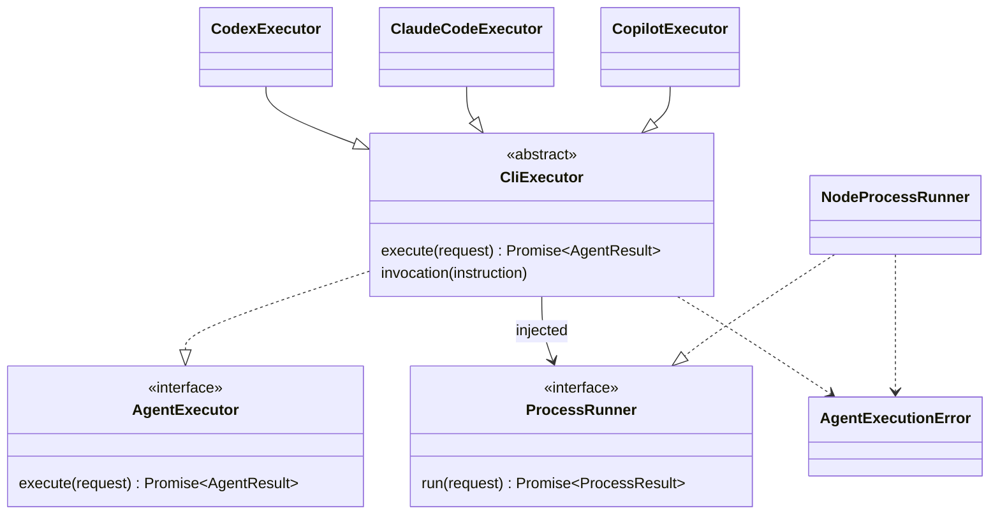

# AgentExecutor

## 実装範囲

`src/agents/executor.ts`にAI CLIの実行層を実装しています。`init`の`--agent`やSpecKitAdapterへの接続はまだありません。Constitutionの生成・保存・検証は後続ワークフローが担当します。

```typescript
interface AgentExecutor {
  execute(request: AgentRequest): Promise<AgentResult>;
}
interface AgentRequest {
  workspace: string;
  instruction: string;
  timeoutMs?: number;
}
interface AgentResult { output: string; }
```

絶対パスの既存ディレクトリ、空でない64 KiB以下の指示を受け取ります。標準出力の前後の空白を除去して返します。これは生成本文の構造検証や承認を意味しません。

## クラスと依存関係



- `CliExecutor`: 内部の抽象基底クラス。入力・作業ディレクトリ・終了コード・空出力を共通検証します。
- 各Executor: ツールごとの引数とstdinの渡し方を定義します。
- `ProcessRunner`: プロセス実行の契約。テストでは差し替えます。
- `NodeProcessRunner`: shellを介さずspawnし、stdout/stderrを収集します。
- `createAgentExecutor(name)`: `codex`・`claude`・`copilot`から実装を選択します。未知の値は拒否します。
- `AgentExecutionError`: `INVALID_REQUEST`・`NOT_FOUND`・`PROCESS_ERROR`・`TIMEOUT`・`OUTPUT_LIMIT`・`FAILED`・`EMPTY_OUTPUT`で失敗を識別します。

## 実行方針

| 実装 | 実行ファイル | 主なオプション | 指示の渡し方 |
|---|---|---|---|
| CodexExecutor | `codex` | `exec --sandbox read-only --skip-git-repo-check --color never -` | stdin |
| ClaudeCodeExecutor | `claude` | `--print --output-format text --tools "" --permission-mode dontAsk` | stdin |
| CopilotExecutor | `copilot` | `--prompt ... --silent --no-ask-user --available-tools view --deny-tool write --deny-tool shell` | 引数 |

初期用途はテキスト生成です。書き込みの全面自動許可やsandboxの解除は行いません。Claudeは組み込みツールを無効化し、Copilotはviewのみに制限します。Codexのread-only設定も含め、これはOS全体やユーザー設定のフックまで隔離する仕組みではありません。CLIのユーザー設定・認証を引き継ぎます。

デフォルトタイムアウトは120秒、stdoutとstderrの合計上限は4 MiBです。超過時は直接起動した子プロセスにSIGKILLを送ります。孫プロセスの終了管理とWindows固有の実行方式は未実装です。

生のstderrをエラーメッセージに自動挿入しません。未インストール、認証失敗、未対応オプションを含む非ゼロ終了は成功扱いにしません。各CLIの事前インストールとログインが必要です。

## プログラムからの利用例

ビルド後、Node.jsモジュールから利用できます。この実行は選択したCLIの認証でAIサービスに指示を送ります。

```javascript
import { createAgentExecutor } from './dist/agents/executor.js';
const executor = createAgentExecutor('codex');
const result = await executor.execute({
  workspace: '/absolute/path/to/project',
  instruction: '指定された目的と制約からConstitutionの下書きをMarkdownで返してください。ファイルは変更しないでください。',
  timeoutMs: 120000,
});
console.log(result.output);
```

## 検証と公式仕様

引数の構築と失敗処理は注入したRunnerで、stdin・UTF-8・起動失敗・タイムアウト・出力制限は実際のNode子プロセスで検証しています。AIサービスへの実接続テストは行っていません。ローカルのCodex/Claudeのヘルプを確認し、Copilotは公式仕様に基づいています。CLIのバージョン差分による未対応オプションは実接続時に確認が必要です。

- [Codex非対話実行](https://developers.openai.com/codex/noninteractive)
- [Claude Code CLI](https://code.claude.com/docs/en/cli-reference)
- [Copilot CLIプログラム実行](https://docs.github.com/en/copilot/reference/copilot-cli-reference/cli-programmatic-reference)
