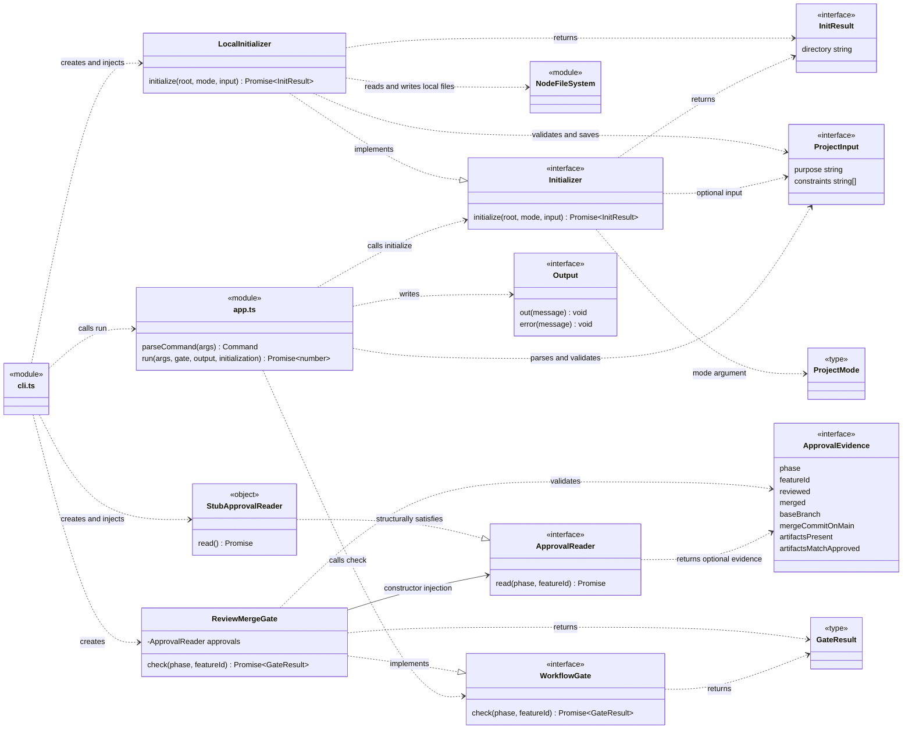
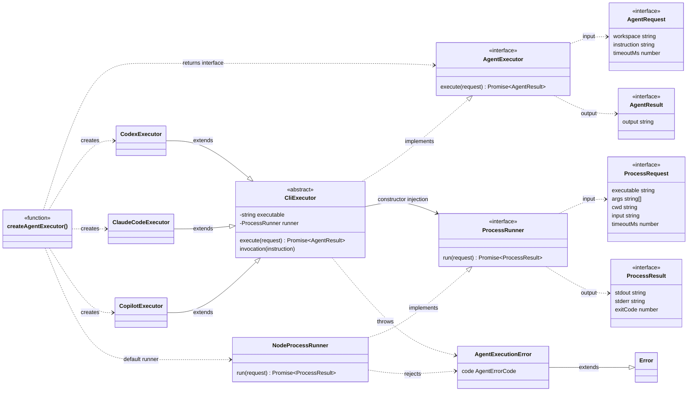
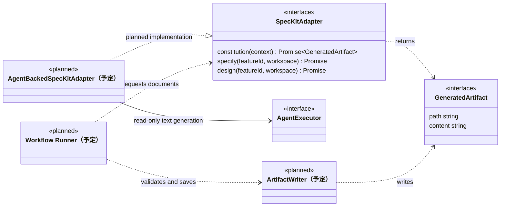
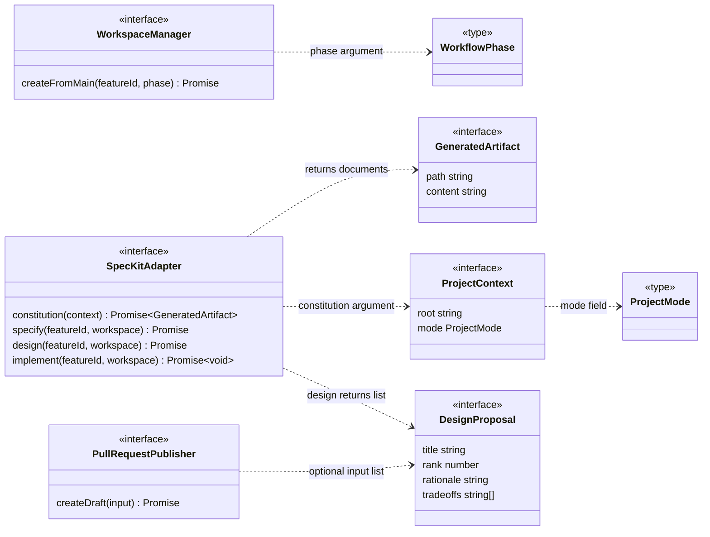
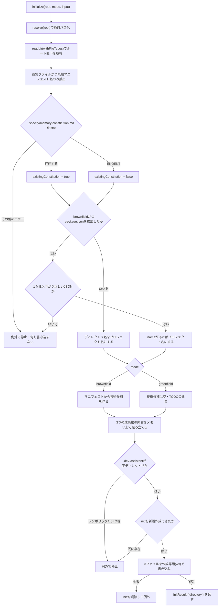
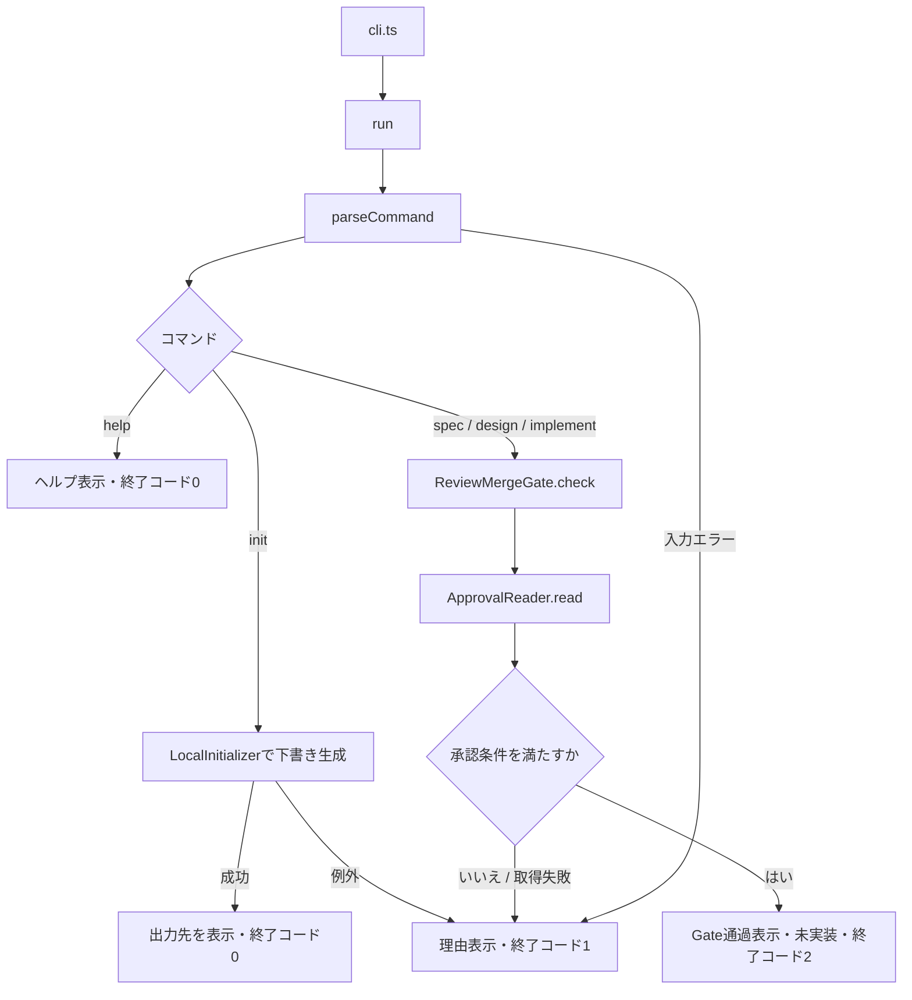
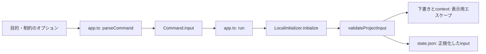

# CLIのクラス・インターフェース概説

現時点のMVPは、ローカル初期化・承認判定のクラス、AI CLIの実行層、CLI処理を担う関数、外部連携に向けたインターフェースで構成されています。この文書は現在の実装と拡張予定を区別して説明します。

## ファイル構成

| ファイル | 責務 |
|---|---|
| `src/cli.ts` | 実行入口。依存を組み立て、引数と出力先を`run()`に渡し、終了コードを設定する |
| `src/app.ts` | コマンドの入力検証と振り分け |
| `src/gate.ts` | 前工程の承認を確認するための契約と共通判定 |
| `src/init.ts` | ローカル初期化の契約と下書き生成 |
| `src/agents/executor.ts` | AI実行の契約、3ツールのExecutor、共通プロセス実行 |
| `src/ports.ts` | worktree・Spec Kit・PR連携に向けた契約とデータ型 |
| `tests/cli.test.mjs` | 入力検証、Gate条件、フェーズ対応、実行入口の基本テスト |
| `tests/init.test.mjs` | 別ディレクトリからのinit、既存ファイル保護、再実行・同時実行、シンボリックリンク、不正JSONのテスト |

## クラス図と依存関係

### 現在の実装

図の`cli.ts`と`app.ts`はTypeScriptモジュールです。`app.ts`の`run()`と`parseCommand()`は公開関数であり、クラスのメソッドではありません。`StubApprovalReader`も名前付きクラスではなく、実行入口で作成している仮のオブジェクトを表します。



点線矢印`..>`は利用、実線矢印`-->`は保持する参照、三角の矢印`..|>`はインターフェースの実装を表します。`ApprovalReader.read()`の正確な戻り値は`Promise<ApprovalEvidence | undefined>`です。

`run()`は`ReviewMergeGate`を直接生成せず、`WorkflowGate`を受け取ります。`ReviewMergeGate`も具体的なGitHubクライアントではなく`ApprovalReader`を受け取ります。`run()`は`Initializer`も引数で受け取ります。これらの境界で依存を注入し、テスト時に差し替えられます。具体的な実装を選んで接続する責務は`cli.ts`に置いています。

### AI実行層（実装済み・CLIワークフローには未接続）

以下は`src/agents/executor.ts`に存在する実装です。`cli.ts`・`LocalInitializer`・`SpecKitAdapter`からの呼び出しはまだないため、それらへの接続線は描いていません。



`--|>`はクラス継承です。3つのExecutorは`CliExecutor`を継承し、共通の`execute()`を利用します。`CliExecutor`は外部へ公開していない抽象基底クラスです。`AgentRequest.timeoutMs`は任意、`ProcessResult.exitCode`は`number | null`で、図では簡略表記しています。

`AgentExecutor`はAI実行の契約、`ProcessRunner`は子プロセス実行の契約です。上位処理は前者だけに依存し、テストでは後者を差し替えてツール固有の引数や失敗を検証できます。`NodeProcessRunner`はshellを介さずプロセスを起動します。詳しい制限と検証範囲は[AI実行層の概説](agent-executors.md)を参照してください。

### Spec Kitとの接続方針（決定済み・未実装）

Spec Kitの文書は**AIにテキストとして生成させ、検証と保存はワークフローが行います**。AIにファイルを書き込ませたり、Spec Kitのコマンド（`/speckit.*`）やスクリプト・フックを実行させたりしません。

理由は次のとおりです。

- Gateは「承認済みの成果物がmain上に変更されずに存在すること」を判定します。どのファイルを何の内容で書いたかをCLI自身が把握している方が、承認内容との照合を設計しやすくなります。
- Codex・Claude・Copilotは書き込み権限の仕組みが異なり、同じ強さで制限できているかを横並びで検証するのは困難です。Executorを読み取り専用に固定すれば、workspaceの設定を読み込まない制限などの安全策をそのまま維持できます。
- Spec Kitのコマンドは自身でファイルを書き込みます。例えば`/speckit.specify`は、Spec Kitが決める`specs/<連番>-<短い名前>/`に`spec.md`やチェックリストを作成し、`.specify/feature.json`を書き込みます。`before_specify`フックが設定されていれば、ブランチの作成も行います（github/spec-kitの`main`ブランチの`templates/commands/specify.md`で確認）。これはFeature IDやworktreeをこのCLIで管理する設計と衝突します。

代わりに失うのは、Spec Kitのコマンドをそのまま呼ぶ手軽さです。Spec Kitのテンプレート（`.specify/templates/`）と承認済みのコンテキストをもとに指示を組み立て、その内容をこのCLIが所定のパスへ保存します。対応するSpec Kitのバージョンは、実装時に固定します。

この方針の対象はconstitution・specify・designです。implementは、複数のソースファイルの変更をどう生成し適用するかを別途決める必要があるため、未決定です。



- `AgentBackedSpecKitAdapter`（予定）: テンプレートとコンテキストから指示を組み立て、読み取り専用の`AgentExecutor`で生成し、`GeneratedArtifact`として返します。ファイルは書き込みません。
- `ArtifactWriter`（予定）: パスがフェーズごとの許可範囲（例: `.specify/memory/constitution.md`、`specs/<featureId>/`配下）に収まること、シンボリックリンクを経由しないこと、既存ファイルを無条件に上書きしないことを検証してから保存します。`LocalInitializer`と同じ保護方針です。
- Workflow Runner（予定）: Adapterの生成とWriterの保存を順に呼び出します。Executorに承認判定やPR作成を持たせません。

`AgentBackedSpecKitAdapter`・`ArtifactWriter`・Workflow Runnerはまだ存在しません。現在のコードにあるのは、`src/ports.ts`の`SpecKitAdapter`・`GeneratedArtifact`の型だけです。

### 外部連携の契約（定義済み・未接続）

以下は現在存在するインターフェース間の型の依存です。ワークフローからこれらを呼ぶ実装はまだありません。



### 拡張時に守る依存の向き

- コマンド処理と今後のWorkflow Runnerはインターフェースに依存し、GitHub・Git・AIの具体的な実装は実行入口で接続する。
- Gateは承認の判定に限定する。worktree作成やPR公開はRunnerが各契約を通じて実行し、Gateから呼び出さない。
- 外部連携アダプターからコマンド処理やRunnerを呼び戻さない。実行順序と失敗時の扱いはRunnerに集約する。
- 承認を確認したmainと、worktreeの作成元を同じコミットに揃える設計が必要。現在の契約にはそのコミットを引き渡す項目がないため、実接続時に拡張する。

現在は`app.ts`が`ProjectMode`を`ports.ts`から、`ports.ts`が`WorkflowPhase`を`gate.ts`から型として参照しています。共有型が増えた場合は、外部連携やCLIに依存しない共通の型ファイルへの切り出しを検討します。現段階で新しい抽象クラスやRunnerを実装したわけではありません。

## クラスとインターフェース

### Initializer（インターフェース）

`src/init.ts`で初期化の契約を定義します。

```typescript
initialize(root: string, mode: ProjectMode, input?: ProjectInput): Promise<InitResult>
```

`root`は初期化するプロジェクトのディレクトリ、`mode`は`greenfield`または`brownfield`です。`run()`は必須の第4引数として`{ initializer, root }`を受け取り、この契約を通じて初期化します。

### LocalInitializer（実装済みのクラス）

`Initializer`を実装します。現在は他のアダプターを注入せず、Node.jsのファイルシステムAPIを直接利用します。処理の順序は次のとおりです。

1. 目的・制約を検証・正規化した後、対象ルート直下の通常ファイルから既知マニフェストを検出する。シンボリックリンクは対象外。
2. 対象ルートからの固定パス`.specify/memory/constitution.md`に、既存のSpec Kit Constitutionがあるかを`lstat`で確認する。ディレクトリの探索や中身の読み込みは行わない。存在しない（`ENOENT`）場合のみ「なし」とし、権限エラーなどその他の失敗は例外として停止する。結果は`state.json`の`existingConstitution`と`context.md`に記録するだけで、Gateの判定や既存ファイルの変更には使わない。
3. greenfieldではディレクトリ名をプロジェクト名にし、マニフェストの内容は読まない。brownfieldでは通常ファイルの`package.json`があれば最大1 MiBまで読み込んで名前を取得する。それ以外はディレクトリ名を使う。不正JSONでは`package.json is not valid JSON: ...`として停止する。
4. brownfieldでは検出したマニフェストから技術候補を下書きに反映する。greenfieldでは採用技術をTODOとして残す。
5. 出力先を検証して`.dev-assistant/init`を新規作成し、3つの成果物を書き込む。
6. 成功時は出力ディレクトリを`InitResult`として返す。



`A`から`L`までは読み取りとメモリ上の処理のみです。入力に問題がある場合は、出力先を作成する前に停止します。

| 成果物 | 内容 |
|---|---|
| `constitution.draft.md` | 未承認の原則候補、目的・技術・制約のTODO |
| `context.md` | 限定的な検出結果、既存Constitutionの有無、次の作業 |
| `state.json` | モード・プロジェクト名・検出情報・`draft`状態 |

既存Constitutionは変更しません。`.dev-assistant`がシンボリックリンクの場合、または`init`が既に存在する場合は停止します。同時実行でも`init`ディレクトリを新規作成できた呼び出しだけが書き込みに進みます。書き込み失敗時は今回作成した`init`ディレクトリの削除を試み、例外を返します。親の`.dev-assistant`は残る場合があります。

このクラスは限定的なローカル検出とテンプレート生成を担当します。ソースの詳細分析、AI生成、Spec Kit実行、Git/worktree操作、PR公開、承認判定は行いません。生成した`state.json`はGateの承認証拠ではありません。

### InitResult（インターフェース）

`{ directory: string }`で、生成した下書きの出力先を返します。`run()`はこの値を成功メッセージに使用します。承認完了やPR情報は含みません。

### ReviewMergeGate（実装済みのクラス）

`WorkflowGate`を実装し、次のフェーズを開始できるか判定します。コンストラクターで`ApprovalReader`を受け取るため、承認情報の取得方法を判定ロジックから分離できます。

`check(phase, featureId?)`は以下を確認し、許可または停止理由を返します。

1. Design・ImplementationにはFeature IDがあること。
2. 前工程の承認情報が存在し、フェーズとFeatureが一致すること。
3. レビュー済みかつmainへマージ済みであること。
4. マージコミットが現在のmainの履歴に含まれること。
5. 必要な成果物が存在し、承認済み内容と一致すること。

取得失敗や情報不足では停止します。Gate自体はGitHub/Gitを直接操作せず、渡された証拠を判定します。worktree作成、ファイル生成、PR作成も担当しません。

### WorkflowGate（インターフェース）

`check(phase: WorkflowPhase, featureId?: string): Promise<GateResult>`を定義します。CLIはこの契約に依存し、具体的な判定クラスの詳細には依存しません。

### ApprovalReader（インターフェース）

`read(phase: ArtifactPhase, featureId?: string)`で前工程の承認情報を取得します。戻り値は`ApprovalEvidence`または`undefined`です。

現在の実行入口では、常に`undefined`を返す仮実装を接続しています。GitHub/Gitを確認する実アダプターは未実装です。将来は、ユーザーが編集した承認フラグではなく、実際のレビュー・マージ・成果物から証拠を取得します。

### WorkspaceManager（契約のみ）

`createFromMain(featureId, phase)`でmainを基点に作業用worktreeとブランチを用意し、そのパスとブランチ名を返すための境界です。実装・呼び出しはまだありません。

現在の`phase`型はSpecification・Design・Implementationのみです。Constitution作成のためのworktreeは、Git連携追加時に契約を拡張するか、別の入口を設ける必要があります。

### SpecKitAdapter（契約のみ）

Spec Kitの文書をAIにテキストとして生成させる境界です。ファイルの書き込み、Spec Kitのコマンド・スクリプト・フックの実行、ブランチ作成は行いません（[接続方針](#spec-kitとの接続方針決定済み未実装)）。

| メソッド | 想定する処理 | 戻り値 |
|---|---|---|
| `constitution(context)` | プロジェクト固有の開発原則を生成 | `Promise<GeneratedArtifact>` |
| `specify(featureId, workspace)` | Featureの仕様を生成 | `Promise<GeneratedArtifact[]>` |
| `design(featureId, workspace)` | 設計文書と設計案を生成 | `Promise<{ artifacts: GeneratedArtifact[]; proposals: DesignProposal[] }>` |
| `implement(featureId, workspace)` | 設計に基づく実装（方式は未決定） | `Promise<void>` |

`GeneratedArtifact`は`{ path: string; content: string }`で、`path`はworkspaceのルートからの相対パスです。パスの検証と保存は呼び出し側（予定の`ArtifactWriter`）が行います。いずれも実装・呼び出しはまだありません。

### PullRequestPublisher（契約のみ）

`createDraft()`でブランチ、タイトル、本文、任意の設計案を受け取り、Draft PRの番号とURLを返す境界です。実装・呼び出しはまだありません。レビューやマージの操作はこの契約に含まれません。

## 主なデータ型

| 型 | 内容 |
|---|---|
| `WorkflowPhase` | `specification`・`design`・`implementation` |
| `ArtifactPhase` | 承認対象となる`constitution`・`specification`・`design` |
| `GateResult` | `{ allowed: true }`または`{ allowed: false; reason: string }` |
| `ApprovalEvidence` | 対象フェーズ/Feature、レビュー・マージ・main上の成果物に関する判定情報 |
| `InitResult` | ローカル下書きの出力ディレクトリ |
| `ProjectMode` | `greenfield`または`brownfield` |
| `ProjectContext` | プロジェクトのルートパスとモード |
| `DesignProposal` | 案の名前、推奨順位、判断根拠、トレードオフ。順位の制約や検証は未実装 |
| `Command` | 検証済みのコマンドとオプション |
| `Output` | 通常出力とエラー出力の関数 |

## 関数と実行入口

`parseCommand()`は引数を検証し、`Command`を返します。不明なコマンド、必須オプションの不足、不正なmodeやFeature ID、余分な引数は例外になります。

`run()`は入力を解析し、helpならヘルプを表示します。initはGateを実行せず、注入されたInitializerでローカル下書きを作成し、成功時は0、例外発生時は1を返します。それ以外はGateを実行し、許可された場合のみ後続の位置へ進みます。spec/design/implementのワークフロー本体は未実装なので、許可後も終了コード2で停止します。

`cli.ts`は`ReviewMergeGate`と仮の`ApprovalReader`を組み立て、`LocalInitializer`と`process.cwd()`を第4引数として渡し、`run()`の戻り値をプロセスの終了コードに設定します。

## 現在の処理フロー



実行入口の仮Readerは承認情報を返さないため、通常のCLIからspec・design・implementを実行するとGateで停止します。Gate通過はテスト用Readerで検証しています。

## フェーズと前工程の対応

| コマンド | Gateのフェーズ | 承認対象 | 範囲 |
|---|---|---|---|
| `dev init --mode greenfield\|brownfield` | Gateなし | なし | プロジェクト |
| `dev spec --feature <id>` | `specification` | `constitution` | プロジェクト共通。ReaderにはFeature IDを渡さない |
| `dev design --feature <id>` | `design` | `specification` | 対象Feature |
| `dev implement --feature <id>` | `implementation` | `design` | 対象Feature |

## 今後の拡張

実ワークフローでは、Gate通過後にworktree作成、承認済みコンテキストの読み込み、Spec Kit実行、検証、Draft PR提示を順に接続する予定です。これを統括するWorkflow Runnerはまだ実装していません。

Designでは複数案・推奨順位・判断根拠・トレードオフをPRに提示できるようにします。initではローカル検出と下書き生成を実装済みです。今後、目的・制約の入力とAI/Spec Kit連携を追加します。既存ファイルの保護、途中失敗からの復旧、再実行時の扱いは各実装時に具体化します。

## 目的・制約のデータ経路

`ProjectInput`は`src/init.ts`で定義する`{ purpose?: string; constraints?: string[] }`です。図のフィールドはどちらも任意です。`validateProjectInput()`は同じモジュールの公開関数で、文字列を検証・トリムし、未指定の制約を空配列に揃えます。

`app.ts`の`parseCommand()`はinitの`--purpose`と反復可能な`--constraint`を解析し、入力があれば`Command.input`に保持します。`run()`は`Initializer.initialize(root, mode, input)`へ渡します。LocalInitializerも書き込み前に検証するため、直接呼ぶ場合にも同じ値の制約が適用されます。

目的は下書きの目的欄、制約はプロジェクト固有の制約欄、両方はコンテキストにも反映します。`state.json`はschemaVersion 2として正規化後の値を`input`に保存します。既存出力の上書き禁止は継続します。これは将来のAI入力となるプロジェクト情報であり、承認情報ではありません。


