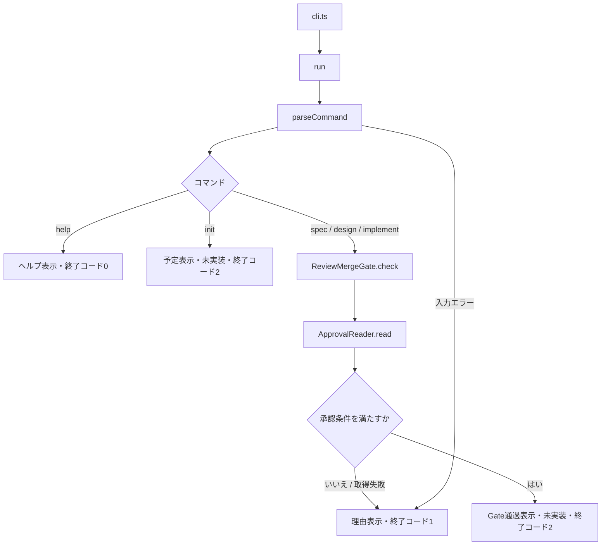

# CLIのクラス・インターフェース概説

現時点のMVPは、1つのクラスと、CLI処理を担う関数、将来の外部連携に向けたインターフェースで構成されています。この文書は現在の実装と拡張予定を区別して説明します。

## ファイル構成

| ファイル | 責務 |
|---|---|
| `src/cli.ts` | 実行入口。依存を組み立て、引数と出力先を`run()`に渡し、終了コードを設定する |
| `src/app.ts` | コマンドの入力検証と振り分け |
| `src/gate.ts` | 前工程の承認を確認するための契約と共通判定 |
| `src/ports.ts` | worktree・Spec Kit・PR連携に向けた契約とデータ型 |
| `tests/cli.test.mjs` | 入力検証、Gate条件、フェーズ対応、実行入口の基本テスト |

## クラスとインターフェース

### ReviewMergeGate（実装済みのクラス）

`WorkflowGate`を実装し、次のフェーズを開始できるか判定します。コンストラクターで`ApprovalReader`を受け取るため、承認情報の取得方法を判定ロジックから分離できます。

`check(phase, featureId?)`は以下を確認し、許可または停止理由を返します。

1. Design・ImplementationにはFeature IDがあること。
2. 前工程の承認情報が存在し、フェーズとFeatureが一致すること。
3. レビュー済みかつmainへマージ済みであること。
4. マージコミットが現在のmainの履歴に含まれること。
5. 必要な成果物が存在し、承認済み内容と一致すること。

取得失敗や情報不足では停止します。Gate自体はGitHub/Gitを直接操作せず、渡された証拠を判定します。worktree作成、ファイル生成、PR作成も担当しません。

### WorkflowGate（インターフェース）

`check(phase: WorkflowPhase, featureId?: string): Promise<GateResult>`を定義します。CLIはこの契約に依存し、具体的な判定クラスの詳細には依存しません。

### ApprovalReader（インターフェース）

`read(phase: ArtifactPhase, featureId?: string)`で前工程の承認情報を取得します。戻り値は`ApprovalEvidence`または`undefined`です。

現在の実行入口では、常に`undefined`を返す仮実装を接続しています。GitHub/Gitを確認する実アダプターは未実装です。将来は、ユーザーが編集した承認フラグではなく、実際のレビュー・マージ・成果物から証拠を取得します。

### WorkspaceManager（契約のみ）

`createFromMain(featureId, phase)`でmainを基点に作業用worktreeとブランチを用意し、そのパスとブランチ名を返すための境界です。実装・呼び出しはまだありません。

現在の`phase`型はSpecification・Design・Implementationのみです。Constitution作成のための作業領域は、init実装時に契約を拡張するか、別の入口を設ける必要があります。

### SpecKitAdapter（契約のみ）

エージェントを通じてSpec Kitへ処理をつなぐ境界です。

| メソッド | 想定する処理 | 戻り値 |
|---|---|---|
| `constitution(context)` | プロジェクト固有の開発原則を生成 | `Promise<void>` |
| `specify(featureId, workspace)` | Featureの仕様を生成 | `Promise<void>` |
| `design(featureId, workspace)` | 設計案を生成 | `Promise<DesignProposal[]>` |
| `implement(featureId, workspace)` | 設計に基づく実装 | `Promise<void>` |

いずれも実装・呼び出しはまだありません。Spec KitのエージェントスキルをOSコマンドとして直接実行する構成ではありません。

### PullRequestPublisher（契約のみ）

`createDraft()`でブランチ、タイトル、本文、任意の設計案を受け取り、Draft PRの番号とURLを返す境界です。実装・呼び出しはまだありません。レビューやマージの操作はこの契約に含まれません。

## 主なデータ型

| 型 | 内容 |
|---|---|
| `WorkflowPhase` | `specification`・`design`・`implementation` |
| `ArtifactPhase` | 承認対象となる`constitution`・`specification`・`design` |
| `GateResult` | `{ allowed: true }`または`{ allowed: false; reason: string }` |
| `ApprovalEvidence` | 対象フェーズ/Feature、レビュー・マージ・main上の成果物に関する判定情報 |
| `ProjectMode` | `greenfield`または`brownfield` |
| `ProjectContext` | プロジェクトのルートパスとモード |
| `DesignProposal` | 案の名前、推奨順位、判断根拠、トレードオフ。順位の制約や検証は未実装 |
| `Command` | 検証済みのコマンドとオプション |
| `Output` | 通常出力とエラー出力の関数 |

## 関数と実行入口

`parseCommand()`は引数を検証し、`Command`を返します。不明なコマンド、必須オプションの不足、不正なmodeやFeature ID、余分な引数は例外になります。

`run()`は入力を解析し、helpならヘルプを表示します。initはGateを実行せず、初期化の予定を表示します。それ以外はGateを実行し、許可された場合のみ後続の位置へ進みます。ただしワークフロー本体は未実装なので、許可後も終了コード2で停止します。

`cli.ts`は`ReviewMergeGate`と仮の`ApprovalReader`を組み立て、`run()`の戻り値をプロセスの終了コードに設定します。

## 現在の処理フロー

実行入口の仮Readerは承認情報を返さないため、通常のCLIからspec・design・implementを実行するとGateで停止します。Gate通過はテスト用Readerで検証しています。

## フェーズと前工程の対応

| コマンド | Gateのフェーズ | 承認対象 | 範囲 |
|---|---|---|---|
| `dev init --mode greenfield\|brownfield` | Gateなし | なし | プロジェクト |
| `dev spec --feature <id>` | `specification` | `constitution` | プロジェクト共通。ReaderにはFeature IDを渡さない |
| `dev design --feature <id>` | `design` | `specification` | 対象Feature |
| `dev implement --feature <id>` | `implementation` | `design` | 対象Feature |

## 今後の拡張

実ワークフローでは、Gate通過後にworktree作成、承認済みコンテキストの読み込み、Spec Kit実行、検証、Draft PR提示を順に接続する予定です。これを統括するWorkflow Runnerはまだ実装していません。

Designでは複数案・推奨順位・判断根拠・トレードオフをPRに提示できるようにします。initではプロジェクト情報を収集し、greenfield/brownfieldに応じたConstitutionを生成します。既存ファイルの保護、途中失敗からの復旧、再実行時の扱いは各実装時に具体化します。
